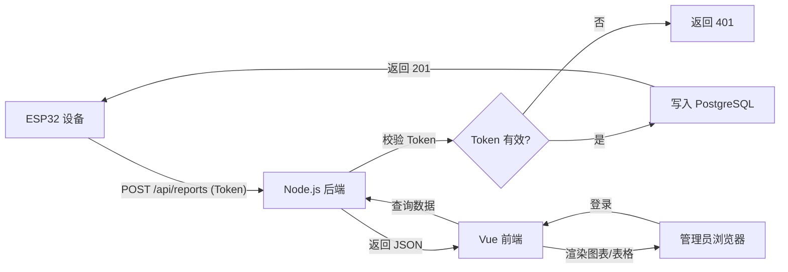

# ESP32S3 智能教室环境监测系统 - 产品需求文档（PRD）

## 1. 产品概述

本项目为基于 ESP32S3 的智能教室环境监测系统配套 WEB 平台，用于接收、存储、展示 ESP32 上报的教室环境数据（光敏1、光敏2、AQI、温度、速度、是否有人），并支持历史数据查询与可视化图表分析。

- **目标用户**：教室管理员、校园后勤运维人员
- **核心价值**：实时掌握教室环境质量，基于历史数据优化教室环境，保障师生健康与学习效率

## 2. 核心功能

### 2.1 用户角色

| 角色 | 登录方式 | 核心权限 |
|------|----------|----------|
| 管理员 | 用户名 + 密码（.env 配置） | 查看数据、查看图表、配置设备上报 Token |
| ESP32 设备 | Token 鉴权 | 通过 API 上报环境数据 |

### 2.2 功能模块

1. **登录页**：管理员身份验证，进入后台
2. **仪表盘**：展示最新一次上报数据、关键指标卡片、实时趋势小图
3. **历史数据**：分页/筛选查询所有历史上报记录，支持导出
4. **图表分析**：基于历史数据生成多维度图表（折线、对比、分布）
5. **系统设置**：配置设备上报 Token、查看接入设备信息

### 2.3 页面详情

| 页面名称 | 模块名称 | 功能描述 |
|----------|----------|----------|
| 登录页 | 登录卡片 | 管理员账号密码登录，JWT 会话保持 |
| 仪表盘 | 最新数据卡片 | 光敏1/光敏2/AQI/温度/速度/是否有人 最新值与状态徽标 |
| 仪表盘 | 设备状态 | 显示最后上报时间、设备在线状态、设备 ID |
| 仪表盘 | 实时趋势 | 最近 24 小时温度/AQI 迷你折线图 |
| 历史数据 | 筛选区 | 时间范围、数据类型、设备 ID 筛选 |
| 历史数据 | 数据表格 | 分页展示历史记录，支持排序 |
| 历史数据 | 导出功能 | 导出当前筛选结果为 CSV |
| 图表分析 | 趋势图 | 多指标随时间变化折线图 |
| 图表分析 | 对比图 | 多日同时段数据对比 |
| 图表分析 | 分布图 | 数据分布直方图/箱线图 |
| 系统设置 | Token 配置 | 查看/重置设备上报 Token |
| 系统设置 | 设备信息 | 已接入设备列表与最后活跃时间 |

## 3. 核心流程

### 3.1 设备数据上报流程
ESP32 通过 HTTP POST 携带 Token 上报数据 → 后端校验 Token → 写入 PostgreSQL → 返回成功确认。

### 3.2 管理员查看数据流程
管理员登录 → 进入仪表盘查看最新数据 → 切换历史数据/图表分析进行深入分析 → 在设置页管理 Token。

## 4. 用户界面设计

### 4.1 设计风格

遵循 Microsoft Fluent Design 设计语言，体现"智能、专业、可信"的教室环境管理气质：

- **主色**：Fluent 主蓝 `#0078D4`（信任、专业），辅以环境主题绿 `#107C10` 作为正向状态色
- **中性色**：Fluent 灰阶体系（`#FAFAFA` 背景 → `#201F1E` 文字）
- **状态色**：成功 `#107C10`、警告 `#F7630C`、危险 `#D13438`、信息 `#0078D4`
- **材质**：Acrylic（亚克力毛玻璃）半透明背景、Mica（云母）沉稳背景、Reveal 光照高亮
- **字体**：Segoe UI（Windows 原生字体），回退至 system-ui；中文使用 Microsoft YaHei UI
- **圆角**：Fluent 标准圆角 4px（控件）/ 8px（卡片）
- **阴影**：Fluent Depth 阴影分层（resting16、floating64）
- **布局**：左侧导航栏 + 顶部命令栏 + 卡片式内容区
- **图标**：Fluent System Icons 线性风格
- **动画**：Fluent 连接动画与缓动函数（cubic-bezier(0.1, 0.9, 0.2, 1)），平滑过渡

### 4.2 页面设计概览

| 页面名称 | 模块名称 | UI 元素 |
|----------|----------|----------|
| 登录页 | 登录卡片 | 居中卡片，亚克力背景，Fluent 输入框，主色按钮，淡入动画 |
| 仪表盘 | 指标卡片网格 | 6 宫格卡片（光敏1/光敏2/AQI/温度/速度/是否有人），大数字+单位+状态徽标+迷你 sparkline，悬浮 Reveal 效果 |
| 仪表盘 | 设备状态条 | 横向信息条，在线指示灯脉冲动画 |
| 仪表盘 | 趋势图卡 | ECharts 折线图，Fluent 主题配色 |
| 历史数据 | 筛选栏 | Fluent DatePicker + ComboBox + PrimaryButton |
| 历史数据 | 数据表格 | Fluent DataGrid 样式，斑马纹，悬浮高亮，分页器 |
| 图表分析 | 图表网格 | 多图表布局，可切换指标/时间维度 |
| 系统设置 | 设置卡片 | 分组卡片，Token 脱敏显示+复制+重置按钮 |

### 4.3 响应式

桌面优先（≥1280px 完整三栏体验），平板（768-1280px）导航折叠为图标，移动端（<768px）单列堆叠+汉堡菜单。

### 4.4 3D 场景

本项目不涉及 3D 场景。
